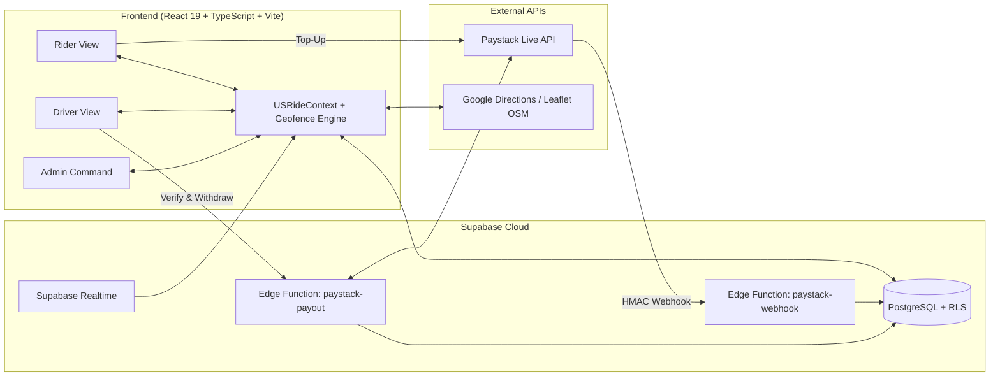

# 🛺 USRide & UCRide — UNIBEN Smart Campus Mobility Platform

[](https://react.dev/)
[](https://www.typescriptlang.org/)
[](https://vite.dev/)
[](https://supabase.com/)
[](https://paystack.com/)

**USRide (UNIBEN Solar Ride)** and **UCRide (UNIBEN Campus Cab)** make up an integrated, real-time campus e-mobility and ride-hailing platform built for the **University of Benin (UNIBEN), Ugbowo Campus**. The system connects students and staff with solar-electric tricycles (Kekes) and campus cabs using proximity-based dispatch, field-calibrated battery telemetry, and instant digital wallet settlements.

---

## ✨ Key Features

### 🎓 Rider Portal
- **Dual Fleet Selection:** Book either a **USRide Solar Keke** (₦100 shared / ₦500 drop) or a **UCRide Campus Cab** (₦250 shared / ₦1,000 drop).
- **Interactive Campus Map & Pin Picker:** Select from 17 verified UNIBEN landmarks (Main Gate, Faculty of Engineering, Hall 1–7, UBTH Gate, Medical Complex, June 12, etc.) or snap GPS coordinates to the nearest landmark.
- **Radial Proximity Dispatch:** Broadcasts ride requests in expanding concentric rings (`1 km → 2 km → ... → 6 km`) around the pickup landmark to match the closest available vehicle.
- **Resilient Trip Synchronization:** Combines **Supabase Realtime** (`postgres_changes`) with a 5-second active polling fallback and cancellation guard so riders never miss a driver acceptance across mobile networks.
- **Digital Wallet & Paystack Top-Up:** Instant wallet funding via **Paystack Popup** (`charge.success` HMAC-SHA512 verified webhook) and one-click saved card checkout.
- **Campus SOS Alert:** One-tap emergency distress broadcast with live landmark, rider details, and assigned vehicle plate number sent directly to UNIBEN Security / Admin.

### 🛺 Driver Portal
- **Live Offer Countdown & Queueing:** 90-second audio-visual incoming ride alert with automatic queue support when finishing an ongoing trip.
- **Field-Calibrated Energy & Battery Model:** Built from 25 real UNIBEN campus test trips on a `96V / 60–64Ah (~6.0 kWh)` solar-electric tricycle battery:
  - Accounts for route distance, passenger load, and campus speed bumps (`2–14 km/h` bump deceleration vs. `20–25 km/h` cruise speed).
- **Daily Profit Tracker (Cabs):** Tracks offline cash collections and daily petrol expenses alongside digital wallet earnings.
- **Live Bank Payouts:** Real-time 10-digit NUBAN bank account name resolution (`GET /bank/resolve`) and instant transfers to Nigerian banks via the `paystack-payout` Supabase Edge Function.

### 🛡️ Admin & Fleet Command Center
- **Live Fleet Telemetry:** Real-time map supervision of all 37 campus vehicles (17 Solar Kekes + 20 Campus Cabs), battery state-of-charge (SoC), seat occupancy, and online status.
- **Financial & Trip Auditing:** Complete ledger of rider top-ups, trip fares, university transfer fees, and driver bank withdrawals.
- **Driver Onboarding & SOS Resolution:** Register new drivers/vehicles and respond to active campus safety incidents.

---

## 🏗️ System Architecture



---

## 📂 Project Structure

```text
usride/
├── src/
│   ├── components/
│   │   ├── UnibenMap.tsx             # Interactive Leaflet map with custom vehicle & landmark markers
│   │   ├── LocationPickerModal.tsx   # Visual pin-picker snapping to nearest UNIBEN landmark
│   │   └── GlobalModal.tsx           # System-wide notification and confirmation modals
│   ├── context/
│   │   └── USRideContext.tsx         # Central state, Supabase Realtime subscriptions & dispatch engine
│   ├── hooks/
│   │   └── useUserLocation.ts        # Live HTML5 geolocation hook with campus fallback
│   ├── lib/
│   │   ├── supabase.ts               # Supabase client initialization
│   │   └── db.ts                     # Typed PostgreSQL CRUD & row-to-model mappers
│   ├── utils/
│   │   ├── geofence.ts               # Haversine distance, UNIBEN bump map, calibrated ETA & battery model
│   │   └── audio.ts                  # Web Audio API synthesized chimes and alerts
│   └── views/
│       ├── LandingPage.tsx           # Entry portal & role selector
│       ├── AuthView.tsx              # Rider & Driver authentication
│       ├── RiderView.tsx             # Booking flow, live trip tracker, wallet & SOS
│       ├── DriverView.tsx            # Dispatch receiver, battery/profit controls & bank payouts
│       └── AdminView.tsx             # University administration & fleet telemetry dashboard
├── supabase/
│   ├── functions/
│   │   ├── paystack-webhook/         # Verifies Paystack signatures & credits rider wallets
│   │   └── paystack-payout/          # Resolves NUBAN accounts & executes live bank transfers
│   └── schema.sql                    # PostgreSQL schema, tables & Realtime publication setup
├── .env.example                      # Template for required environment variables
└── CONTRIBUTING.md                   # Open-source contribution guidelines
```

---

## 🚀 Getting Started

### 1. Prerequisites
- **Node.js** `>= 20.x` and **npm** `>= 10.x`
- A **Supabase** project (for PostgreSQL database, Realtime, and Edge Functions)
- A **Paystack** account (for wallet top-ups and bank account resolution/payouts)

### 2. Clone & Install
```bash
git clone https://github.com/Nsoforgit/usride.git
cd usride
npm install
```

### 3. Configure Environment Variables
Copy `.env.example` to `.env` and fill in your credentials:
```bash
cp .env.example .env
```

| Variable | Description |
| :--- | :--- |
| `VITE_SUPABASE_URL` | Your Supabase project URL |
| `VITE_SUPABASE_ANON_KEY` | Your Supabase anonymous public key |
| `VITE_PAYSTACK_PUBLIC_KEY` | Your Paystack public key (`pk_live_...` or `pk_test_...`) |
| `VITE_GOOGLE_MAPS_API_KEY` | *(Optional)* Google Maps Directions API key for road-snapped polylines |

### 4. Database & Edge Functions Setup
1. Open your **Supabase SQL Editor** and run `supabase/schema.sql` to create the required tables (`riders`, `drivers`, `vehicles`, `trips`, `wallet_transactions`, `saved_cards`, `safety_incidents`).
2. Deploy the Supabase Edge Functions and set your Paystack secret key:
   ```bash
   npx supabase secrets set PAYSTACK_SECRET_KEY=sk_live_your_secret_key
   npx supabase functions deploy paystack-webhook
   npx supabase functions deploy paystack-payout
   ```

### 5. Run Locally
```bash
npm run dev
```
Build for production:
```bash
npm run build
```

---

## 🤝 Contributing

We welcome contributions from developers, students, and researchers interested in sustainable campus mobility! Please read our **[Contributing Guide](CONTRIBUTING.md)** for details on our branch workflow, coding standards, and how to submit a Pull Request.

---

## 📄 License

Distributed for academic and campus mobility innovation at the **University of Benin (UNIBEN)**.
